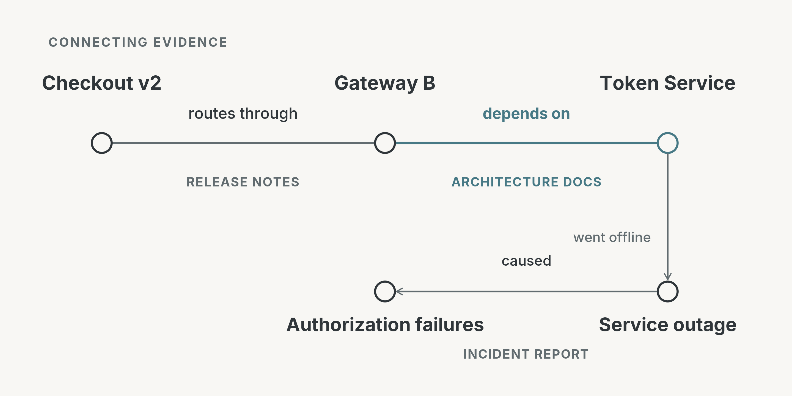
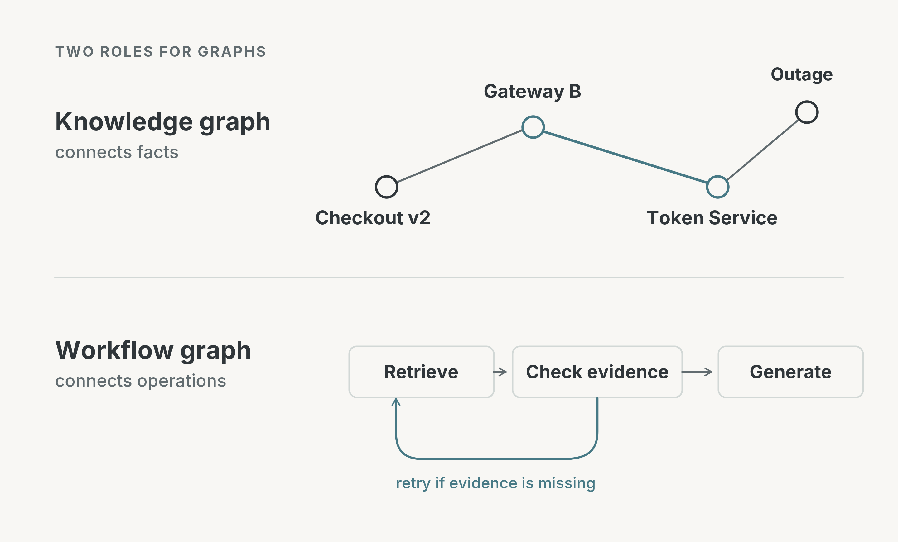

# RAG Can Find Relevant Documents and Still Miss the Answer

*Beyond better retrieval: what a comprehensive survey reveals about using graphs to structure knowledge, retrieval, prompting, and RAG workflows.*

Imagine you've built a RAG assistant for your company's internal documentation.

A developer asks:

**"Why did payments start failing after the latest checkout release?"**

The answer is somewhere in the documentation, but it's spread across three different files.

**Release notes:** Checkout v2 routes payments through Gateway B.

**Architecture documentation:** Gateway B depends on the Token Service to authorize transactions.

**Incident report:** During the rollout, the Token Service experienced an outage, causing authorization failures.

A conventional RAG system searches for text chunks similar to the question. It might retrieve the release notes and incident report but miss the architecture document connecting the new checkout flow to the affected service.

All the necessary information exists. The challenge is discovering the relationships between these pieces of evidence.

This illustrates a limitation of similarity-based retrieval: **the information needed to answer a question isn't always the information that most closely resembles the question.**

GraphRAG offers another way to approach this problem by explicitly representing relationships between entities and using those connections during retrieval.

But after reading *Graph-Based Approaches and Functionalities in Retrieval-Augmented Generation: A Comprehensive Survey* by Zhu et al., I found the broader perspective more interesting.

Based on an analysis of over 200 studies, the authors argue that graphs can influence not only what information a RAG system retrieves, but also how that information is represented, presented to an LLM, and processed throughout the pipeline.

This article focuses on those architectural distinctions and what they mean when designing RAG systems.

## Why not just improve traditional retrieval?

Before introducing graphs, there's an important question worth addressing.

**Couldn't we solve our checkout example without GraphRAG?**

Yes. There are several ways.

We could use **hybrid search**, combining vector similarity with keyword-based retrieval. This might increase the likelihood of finding the relevant architecture document.

Alternatively, we could use **iterative retrieval**.

After retrieving the release notes, the assistant discovers that Checkout v2 uses Gateway B. It could generate a follow-up query:

*"What does Gateway B depend on?"*

That search might retrieve the architecture document, revealing the Token Service dependency.

Another query could then identify the outage.

In fact, a well-designed iterative RAG system could potentially collect exactly the same evidence as a graph-based system.

So why introduce graphs?

The difference isn't simply that graphs can retrieve information across multiple steps. **It's that graphs make certain relationships explicit and directly queryable.**

Hybrid retrieval improves how we rank and find text. Iterative retrieval improves how we explore information through successive queries.

Graph-based retrieval adds another capability: it can search over relationships whose types, directions, and connections are already represented in a structured form.

This can be particularly useful when questions repeatedly depend on the same kinds of relationships, such as service dependencies, organizational hierarchies, or connections between scientific concepts.

Rather than asking an LLM to discover each relationship through another text search, the system can traverse relationships that have already been extracted and indexed.

That's a more specific—and more useful—reason to consider GraphRAG than simply saying it performs better retrieval.

## From documents to connected evidence

Let's return to the checkout incident.

We could construct a graph containing the following relationships:

- Checkout v2 → routes through → Gateway B
- Gateway B → depends on → Token Service
- Token Service → went offline → Service outage
- Service outage → caused → Authorization failures

The concepts are represented as *nodes*, and their relationships as *edges*.

Notice that the outage is represented separately from the Token Service. The service is a component of the application; the outage is an event that affected it.

This distinction matters because not every relationship expresses the same kind of information. A dependency is different from an outage, and an outage is different from a verified causal explanation.

Now consider how retrieval could work.

The system identifies Checkout v2 as the starting entity and follows the `routes_through` relationship to Gateway B.

From Gateway B, it follows `depends_on` to the Token Service.

It can then find incident events associated with that service, including the service outage.

Finally, it retrieves the original incident report supporting the relationship between the outage and the authorization failures.

**The system follows a specific sequence of relationship types rather than repeatedly searching for semantically similar passages.**

Of course, the graph path alone doesn't establish why payments failed. The incident report provides the causal evidence. A properly designed system should preserve links from extracted relationships back to their original documents.

This makes the retrieved evidence easier to inspect and verify.

### Where is the actual advantage?

Consider how the approaches differ:

| Approach | How it finds connected evidence |
|---|---|
| Vector search | Ranks text by semantic similarity |
| Hybrid search | Combines semantic and lexical signals |
| Iterative RAG | Generates additional queries to discover missing information |
| Graph-based retrieval | Traverses explicitly represented entities and relationships |

The meaningful advantage of graph-based retrieval is the ability to perform **relationship-aware queries**.

For example, a system could search for services that depend on a failed component, restrict results to incidents within a particular time interval, or retrieve paths matching a sequence of relationship types.

The survey highlights these capabilities, including multi-hop path composition, structural constraints, and evidence provenance.

For questions that involve predictable relationships, this can make retrieval more systematic and controllable.

But obtaining these capabilities requires building and maintaining the graph in the first place.

## The broader idea: graphs throughout the RAG architecture

GraphRAG is often used to describe systems that retrieve information from knowledge graphs.

The survey adopts a broader perspective.

Instead of defining GraphRAG through one retrieval mechanism, the authors examine how graph techniques contribute to different parts of a RAG system.

Their analysis covers four areas:

**Graph-powered databases:** How entities, documents, and relationships are represented and stored.

**Graph-driven retrieval and prompting:** How graph information is selected and transformed into evidence the LLM can use.

**Graph-structured pipelines:** How retrieval, evaluation, and generation operations are connected and controlled.

**Graph-oriented tasks:** The kinds of problems these approaches support, including knowledge graph question answering, graph prediction, and domain-specific applications.

The first three concern different parts of system architecture. The fourth concerns the tasks those systems are designed to solve.

This distinction is important because it separates several techniques that are frequently grouped under the same GraphRAG label.

It also shows that adding a knowledge graph is only one possible way to introduce graph structure into RAG.

## 1. Graphs for storing knowledge

The first architectural decision is how to represent the information the system needs.

The survey distinguishes between using existing knowledge graphs and constructing graphs from documents.

Existing graphs provide structured entities and relationships that can be queried directly. However, they may not contain the specialized or frequently changing information an application requires.

For internal company documentation, generating a graph from text may be more useful.

An LLM could extract a relationship such as:

`(Gateway B, depends_on, Token Service)`

By repeating this process across documents, the system can construct a graph reflecting the application's own architecture.

But this creates an additional dependency: **retrieval quality now depends partly on graph-construction quality.**

If an extraction model omits a critical dependency, the graph cannot retrieve it. If it invents a relationship or merges two distinct entities, graph traversal may lead to misleading evidence.

The problem becomes more complicated when information changes over time.

A dependency that existed during last month's incident may no longer exist today.

For that reason, graphs benefit from retaining source references, timestamps, and other information needed to validate relationships.

A knowledge graph should not be treated as an unquestionable source of truth. It is a structured representation of evidence that still needs to be checked against its sources.

## 2. Graphs for retrieval and prompting

Once a graph exists, the system needs to select relevant information from it.

For a small dependency graph, following a few predefined relationships might be sufficient.

For a graph containing millions of entities, retrieval becomes more challenging.

The survey examines approaches ranging from traditional graph traversal and probabilistic ranking to learning-based methods that identify relevant nodes and relationships.

The engineering decision is about how much flexibility the retrieval task requires.

Simple graph traversal can be predictable and efficient when the desired relationships are known. Learning-based methods may be useful when relevance depends on complex patterns, but require additional computation and potentially training data.

Retrieval is only one part of the problem, however.

After selecting a subgraph, we must decide how to present it to the LLM.

We could preserve the structured representation:

`(Gateway B, depends_on, Token Service)`

Or translate it into natural language:

*"Gateway B depends on the Token Service."*

The survey examines *topology-aware prompting*, which preserves graph structure explicitly, and *text prompting*, which expresses graph information in language.

The choice matters because the same evidence can be easier or harder to interpret depending on its representation.

For simple relationships, natural language may be sufficient. For more complicated graphs, explicitly preserving connections and their directions can help communicate the structure.

There is also a context-window trade-off. Sending hundreds of relationships to an LLM may introduce unnecessary information rather than improve the answer.

**A useful graph retriever should return not just relevant information, but a compact representation of the relationships needed to answer the question.**

## 3. Graphs for controlling the workflow

This is where the survey moves beyond the usual understanding of GraphRAG.

So far, graphs have represented knowledge: services, incidents, dependencies, and the relationships between them.

But a graph can also represent the RAG system's own processing steps.

Consider the familiar pipeline:

**Question → Retrieve → Generate → Answer**

It's a sequential workflow.

Now imagine our checkout assistant retrieves the release notes but has insufficient evidence to explain the payment failures.

Instead of generating an incomplete answer, the system could evaluate the retrieved evidence and decide to search again.

This introduces a feedback loop.

A workflow could contain operations such as:

- Retrieve evidence.
- Evaluate whether the evidence is sufficient.
- Refine the query and retrieve again if necessary.
- Generate an answer when sufficient evidence is available.

The survey distinguishes sequential, loop, and tree-structured pipelines.

Sequential pipelines execute steps in a fixed order. Loop pipelines support repeated retrieval or refinement. Tree pipelines explore multiple subquestions or reasoning branches before combining the results.

For example, investigating the checkout incident could involve two branches: one examining changes introduced by the release, and another examining incidents recorded during the rollout.

These structures provide different ways to coordinate a complex retrieval task.

But the key distinction is that **a workflow graph does not require a knowledge graph**.

The system could retrieve information from a conventional vector database and still use a graph-structured workflow to decide whether to retry, branch, or generate an answer.

In other words:

**A knowledge graph describes what the system knows. A workflow graph describes what the system does.**

The two are complementary, but they address different engineering problems.

## What does this look like in practice?

Two technologies discussed in the survey illustrate the distinction.

**Microsoft GraphRAG** focuses on organizing knowledge extracted from document collections.

One of its techniques is identifying communities of related entities and generating summaries of those communities.

This is useful for questions that require understanding broader patterns across a large corpus, such as identifying recurring themes in customer feedback.

Rather than retrieving only a few similar chunks, community summaries provide a way to organize information at a higher level.

**LangGraph**, on the other hand, is a framework for building workflows involving connected operations, conditional branches, and feedback loops.

For example, it can help implement a RAG workflow that evaluates retrieved evidence and retries when necessary.

LangGraph isn't inherently a knowledge-graph retrieval system, and using it doesn't automatically make an application GraphRAG in the conventional sense.

The survey includes such workflow frameworks because it examines graph structure more broadly, including the organization of retrieval and generation processes.

These two examples make an important architectural distinction concrete: graphs can structure either the information being processed or the process itself.

## When should you actually use graphs?

The practical decision starts with identifying the limitation of your current RAG system.

| Your problem | What to consider |
|---|---|
| Answers are usually found in individual chunks | Conventional or hybrid RAG |
| Relevant information is missed because search queries are incomplete | Query expansion or iterative retrieval |
| Answers repeatedly require traversing known relationships | Graph-based retrieval |
| Questions ask for broad themes across many documents | Community-based graph summarization |
| Retrieval needs retries, verification, or branching | Graph-structured workflows |

These are possible starting points, not universal architectural rules.

For example, iterative retrieval and graph traversal can work together. A system might use vector search to identify starting entities, then expand along graph relationships to gather supporting evidence.

The costs also differ.

Hybrid search can often be introduced without changing how knowledge is represented. Graph-based retrieval may require entity extraction, relationship validation, indexing, and ongoing maintenance.

A graph becomes especially valuable when those structural relationships are useful across many queries, rather than being reconstructed for a single question.

This is also where the survey's discussion of future research becomes relevant.

Improving graph construction, handling changing relationships, and selecting only the most useful information for prompts are not minor implementation details. They determine whether graph-based techniques can deliver practical benefits without excessive cost.

A larger graph or more elaborate workflow isn't necessarily a better one.

The useful measure is whether the additional structure improves evidence retrieval, reasoning quality, or control over the system enough to justify its complexity.

## Final thoughts

The central contribution of Zhu et al.'s survey is not another GraphRAG algorithm. It's a broader framework for understanding the roles graphs can play across RAG systems.

Graph-based retrieval becomes interesting when explicit relationships provide something that text similarity alone doesn't represent directly. Graph-based prompting addresses how those relationships are communicated to the LLM. Graph-structured workflows address how the system organizes retrieval, verification, and generation.

These capabilities solve different problems and can be combined with conventional RAG techniques.

**The useful question isn't simply whether your RAG system needs a graph. It's which relationships or processing decisions your current architecture struggles to represent—and whether making them explicit would improve the system.**

---

### Reference

Zhu, Z., Huang, T., Wang, K., Ye, J., Chen, X., & Luo, S. (2026). *Graph-Based Approaches and Functionalities in Retrieval-Augmented Generation: A Comprehensive Survey.* ACM Computing Surveys, 58(10), Article 261. https://doi.org/10.1145/3795880
